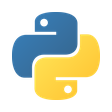
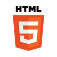
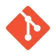
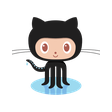
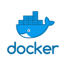
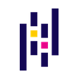

# Tidy Web

**Imagine it. Build it.**

I'm Phil. I am a craftsman. I like building new things to help people turn what they imagine into something that works. I work with them to understand the goal, explore the available paths and make each step clear as we go.

Today I work with code and AI—the best tools I've encountered for that work. I build applications, working systems and guides that help people understand and use them.

<picture><source media="(prefers-color-scheme: dark)" srcset="assets/toolkit-bare/responsive/flask-dark.png"></picture>

<picture><source media="(prefers-color-scheme: dark)" srcset="assets/toolkit-bare/responsive/codex-dark.png"></picture><picture><source media="(prefers-color-scheme: dark)" srcset="assets/toolkit-bare/responsive/openai-dark.png"></picture>

## Start here

- **[PickArt](https://github.com/TidyWeb/pickart-project):** A client project connecting cloud automation, marketing and design. I built a publishing robot, ran a £250 campaign that generated 21,895 website link clicks, and developed a working website-redesign proposal to address the weak sales response.
- **[SkillMatch](https://github.com/TidyWeb/SkillMatch):** Built with a five-person hackathon team to help early-career data job seekers in the West Midlands. A live app matches candidate-confirmed skills to vacancies, alongside profile guides and a local Claude workflow for tailoring a CV to a job.
- **[Birmingham Healthy Life](https://tidyweb.github.io/Birmingham-Healthy-Life/):** I investigated why neighbouring Birmingham areas can differ by up to 16 years in healthy life expectancy, using notebooks, modelling and an interactive dashboard to explain the findings.

## What I'm working on

I'm continuing SkillMatch and moving the PickArt redesign proposal towards a shop that can be tested with its owner.

## A craftsman's habit

I'm a craftsman by instinct. Carpentry and fabrication taught me to work with what's in front of me; theatre, screen and editorial work taught me how ideas reach people. I still measure twice, and aim to understand the problem before choosing the tools.

## Making technical things understandable

[Machine learning, the big picture](https://tidyweb.github.io/machine-learning-big-picture/) · [Algorithms simplified](https://tidyweb.github.io/Algorithms-Simplified/) · [Clustering](https://tidyweb.github.io/clustering-guides/) · [Tableau](https://tidyweb.github.io/tableau-learning-library/) · [Power BI](https://tidyweb.github.io/power-bi-learning-library/) · [SQL](https://tidyweb.github.io/tidyweb-learn-sql/) · [Critical thinking](https://tidyweb.github.io/critical-thinking-field-guide/)
